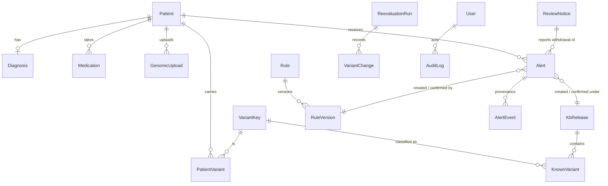
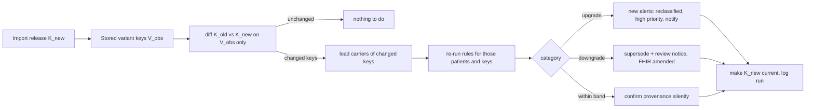

# GE-EHR architecture

A three-layer Flask application: web pages and terminal commands (presentation) call a service
layer (all clinical logic), which stores everything through SQLAlchemy (SQLite by default,
PostgreSQL optional). The binding design contract is [SPEC.md](SPEC.md); this page is the map.

## Modules F1–F5 → code

| Paper module | Code |
|---|---|
| F1 Patient and genomic records | `ge_ehr/services/patient_records.py` (patients, diagnosis, medications, VCF ingest), `services/vcf_parser.py` + `services/vcf_backend.py` (validation, cyvcf2 or the equivalent pure-Python reader), pages in `ge_ehr/patients/`, commands in `commands/patient_cmds.py` |
| F2 Variant alerts / classification | `services/clinvar.py` (import of versioned ClinVar releases, writer, release diff, download of the 7-gene subset), `services/classification.py` (CLNSIG → ACMG/AMP class, review stars, expert panel, KCNJ11/ABCC8 mechanism) |
| F3 Decision support | `services/rules.py` (rule-set validation, pure Algorithm 1), `services/alerting.py` (reconciling findings with stored alerts and notes, provenance events, rule-version import), `data/rules/ruleset_v1.json`, `ruleset_v2.json` |
| F4 FHIR export | `services/fhir_export.py` (Genomics Reporting variant and diagnostic-implication Observations in an R4 Bundle, validated with `fhir.resources`), `ge_ehr/api/routes.py` (`GET /patients/<id>/fhir`) |
| F5 Re-evaluation engine | `services/reevaluation.py` (change-driven Algorithm 2, full recomputation, rule revisions, run bookkeeping, point-in-time view) |

Other parts: `ge_ehr/models.py` (data model), `security.py` (roles, audit), `auth/` and `admin/`
(login, users, audit log), `main/` (dashboard), `alerts/` (inbox, review, notices), `knowledge/`
(releases, rules, runs), `demo.py` (demo seeding), `evaluation/` (paper §5 harness).

## Data model

- **VariantKey** = (chrom, pos, ref, alt) on GRCh38 — the exact-match identity shared by patient
  variants and ClinVar records.
- Every ClinVar import is a **KbRelease** with its own copy of the panel records (**KnownVariant**);
  activation gives releases a sequence number, so earlier evidence is never lost.
- Rules are versioned (**RuleVersion**, definition stored verbatim as JSON).
- **Alerts are never deleted**: status `active` → `reviewed` or `superseded`, each change written
  as an **AlertEvent** with the release, rule version, classification and a snapshot of the text.

## Flows

**VCF upload / medication or diagnosis change (F1→F2→F3).** `patient_records` parses and stores
the panel variants, classifies new ones against the current release, then
`alerting.evaluate_patient_now` runs Algorithm 1 for that patient and reconciles the result with
the stored alerts: new findings are created, findings that no longer apply are superseded,
unchanged ones keep their provenance.

**New ClinVar release (F5, change-driven).**

Work scales with the number of changed variants and their carriers, not with the size of ClinVar.
A rule revision re-runs the revised rule for the carriers of its genes. `strategy="full"`
re-checks every patient and gives the same final state (verified by randomized equivalence
tests and by the evaluation).

**Point-in-time view.** `reevaluation.alerts_as_of(patient, at)` returns the alerts current at
any moment; the text, rule version and release shown are taken from the provenance snapshots,
so "what did the system recommend on that date, and on what evidence" is reproducible.

## Design decisions and deviations from the paper/spec

- **Notes vs alerts**: when the genetic criterion matches but the therapy/diagnosis condition
  does not, an information note is stored (not an alert) explaining why.
- **Zygosity**: D1–D3 and D5 apply to heterozygous carriers (autosomal-dominant MODY);
  homozygous variants get a note recommending specialist referral (possible recessive form).
- **Review notices** are raised whenever a ClinVar change withdraws a non-info alert, including
  mechanism-only (condition) changes for KCNJ11/ABCC8, so a treatment recommendation never
  disappears silently.
- **Mechanism** for KCNJ11/ABCC8 is inferred from the ClinVar condition text (neonatal diabetes /
  DEND → activating; hyperinsulinism → inactivating), because ClinVar has no gain-of-function flag.
- **CLNSIG normalisation**: `Pathogenic/Likely_pathogenic` → LP (conservative, still actionable);
  any *Conflicting* → VUS; unknown or non-ACMG terms → "not classified" (never VUS).
- **FHIR**: validated with the R4B models of `fhir.resources` (structurally identical to R4 for
  these resources); removed variants keep an *amended* diagnostic implication.
- **VCF parsing**: cyvcf2 (htslib) as in the paper where it can be installed; an equivalent
  pure-Python reader otherwise (Windows), selected automatically (`GE_EHR_VCF_BACKEND`).
- **Synthetic knowledge base**: the build environment could not reach NCBI, so the demo and the
  controlled evaluation use synthetic ClinVar-format releases (marked in their headers);
  `scripts/fetch_clinvar.py` and `flask clinvar sync` work with the real files.
- **Local only**: SQLite in `instance/`, waitress server bound to 127.0.0.1, a random session key
  created on first start. PostgreSQL is supported through `DATABASE_URL`.

## Security

Role checks on every route and command (admin / clinician / lab technician; lab technicians
never see recommendations), CSRF protection on every form, hashed passwords with lockout after
repeated failures, strict security headers (CSP `default-src 'self'`, all assets served
locally), upload size limits, and an audit log of logins, uploads, changes, reviews, imports and
denied access.
